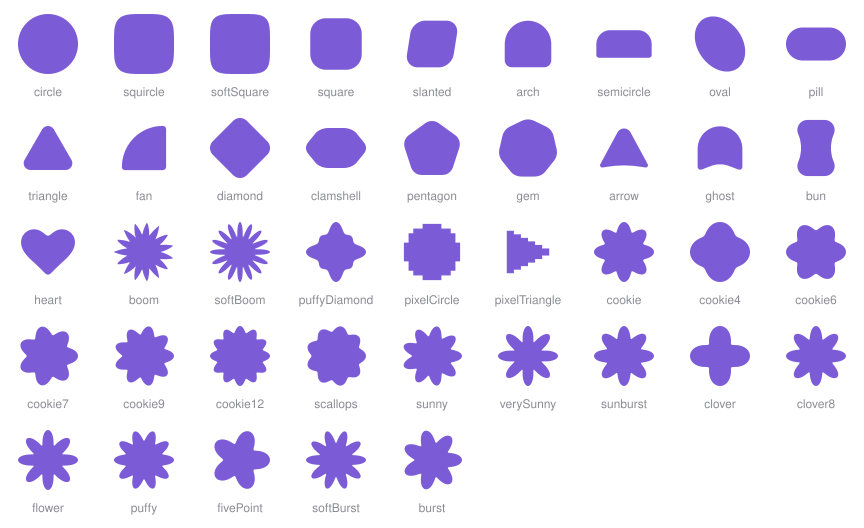
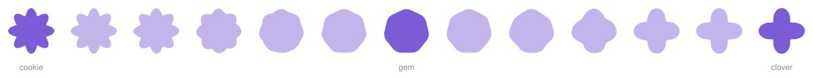

# shapemorph

Shapes in the style of Material 3 Expressive that morph point-for-point into one another, plus springs that keep the hand's momentum. The core has no framework, the DOM drivers are plain JavaScript, and the React hooks are optional. There are no runtime dependencies.

<p align="center"></p>

- **About 40 named shapes**: cookies, clovers, sunny, gem, pentagon, arch, fan, ghost, heart, pixel shapes… and constructors for your own (`lobed`, `regular`, `polygon` with real rounded corners, `pill`, `squircle`, `ellipse`, `star`, `harmonic`, `pixel`).
- **Any shape morphs into any other.** Every shape is sampled at the same 144 points, with winding and start point aligned, so a morph never crumples or spirals.
- **Drivers for real elements.** They morph an element's own silhouette (`clip-path`) or an SVG path, by spring or tween. They can be interrupted mid-morph, the first frame is drawn synchronously, a timer finishes the morph if the tab is hidden, they honour `prefers-reduced-motion`, and they put back the element's own styles.
- **A loader that needs no JavaScript per frame** (SVG SMIL).
- **M3 Expressive spring tokens**, also available as CSS `linear()` easings.

## The shapes



## A morph, frame by frame

Cookie to gem to clover. Every outline has the same 144 points, so a morph moves each point straight to its partner.



## Install

```sh
npm install shapemorph
```

No build step? Copy `dist/shapemorph.min.js` (about 14 KB, core plus DOM drivers in one ES module) into your project and import it:

```html
<script type="module">
  import { shapes, morph } from './vendor/shapemorph.min.js';
</script>
```

You can also load it from a CDN: `import … from 'https://esm.sh/shapemorph@0.1'`.

## Plain JS

```js
import { shapes, morph, setShape, loop, settle, loaderSVG } from 'shapemorph/dom';

setShape(avatar, shapes.cookie);          // draw at once
morph(avatar, shapes.clover);             // spring morph from what's on screen
morph(avatar, shapes.gem, { via: 'tween', duration: 500 });

const busy = loop(button, { size: 44 });  // the busy state: morph and spin
await busy.rest();                        // settle into the resting squircle
busy.stop();                              // give the button back

settle(chip);                             // one-shot arrival: lobed → squircle
el.innerHTML = loaderSVG({ size: 48 });   // SMIL loader
```

`morph` works on any element (it sets `clip-path`, sized to the element) or on an SVG `<path>` (it sets `d`, in a 100-unit box by default: `viewBox="0 0 100 100"`).

## React

```jsx
import { useMorph, useShapeMorph, useShapeSettle, ShapeBadge, LoadingShape } from 'shapemorph/react';

useMorph(ref, selected ? 'squircle' : 'cookie');
useShapeMorph(isSending, buttonRef, 44);
<ShapeBadge shape="gem" hoverShape="flower" fill="#6750a4"><Icon /></ShapeBadge>
<LoadingShape size={48} state={done ? 'rest' : 'loading'} />
```

## Geometry (no DOM)

```js
import { sample, toPath, pathFor, clipPath, lerpPoints, shapeForKey, lobed } from 'shapemorph';

pathFor(shapes.pentagon, 100);             // SVG path in a 100×100 box
clipPath(shapes.squircle, 44);             // "path('…')" for a 44px element, cached
const a = sample(shapes.circle), b = sample(lobed(6, 0.2));
toPath(lerpPoints(a, b, 0.5), { cx: 1, cy: 1 });
shapeForKey(form.title);                   // the same key always gets the same shape
```

## Springs

```js
import { spring, SPRINGS, springCurve } from 'shapemorph';

const stop = spring({ from: x, to: 0, velocity: flickSpeed, ...SPRINGS.fastSpatial, onUpdate: (v) => (el.style.translate = `${v}px`) });
const { easing, duration } = springCurve(SPRINGS.defaultSpatial);   // for CSS transitions
```

## CSS-only morphs

`shapemorph/shapes.css` declares `--sm-shape-<name>` for every shape. It also adds `[data-sm-shape="<name>"] { d: var(…) }`, so a `<path>` changes shape when its attribute changes and animates with a `transition: d …`. **Safari and WKWebView do not support CSS `d`.** Check `supportsCSSPathMorph()` and use `morph()` when it returns false. `shapeTokensCSS()` generates a custom set.

## Pictures

The pictures in this README are drawn by the library itself: `npm run build && npm run readme-images`.

## Browser support

The JS morphs need `clip-path: path()` (Safari 13.1+, Chrome 88+, Firefox 97+) or plain SVG. They are tested in Chromium and in macOS WebKit (WKWebView).

## Credits

The shapes and spring values are modelled on Google's Material 3 Expressive design. This project is independent and not affiliated with or endorsed by Google. It contains no Material source code.

## License

MIT © James Dominguez
